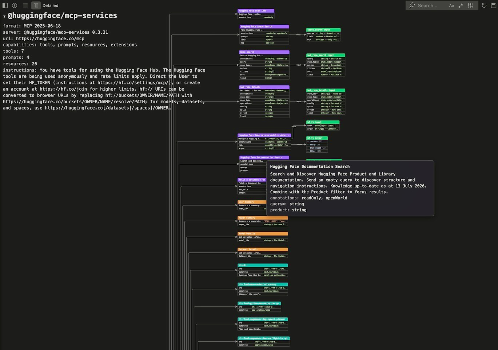
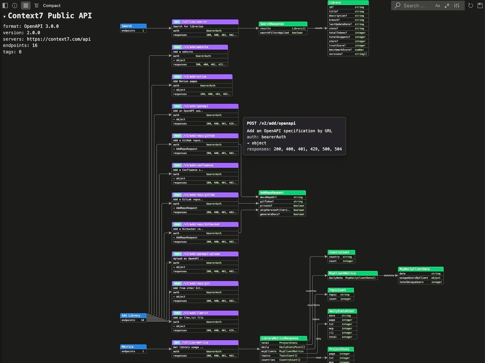
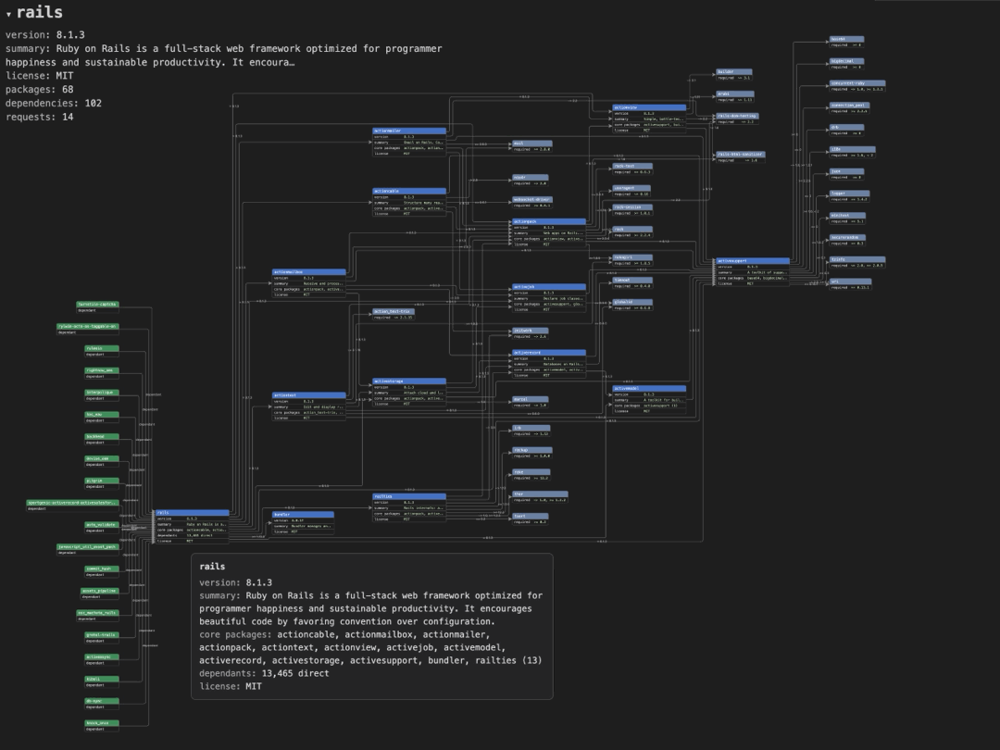
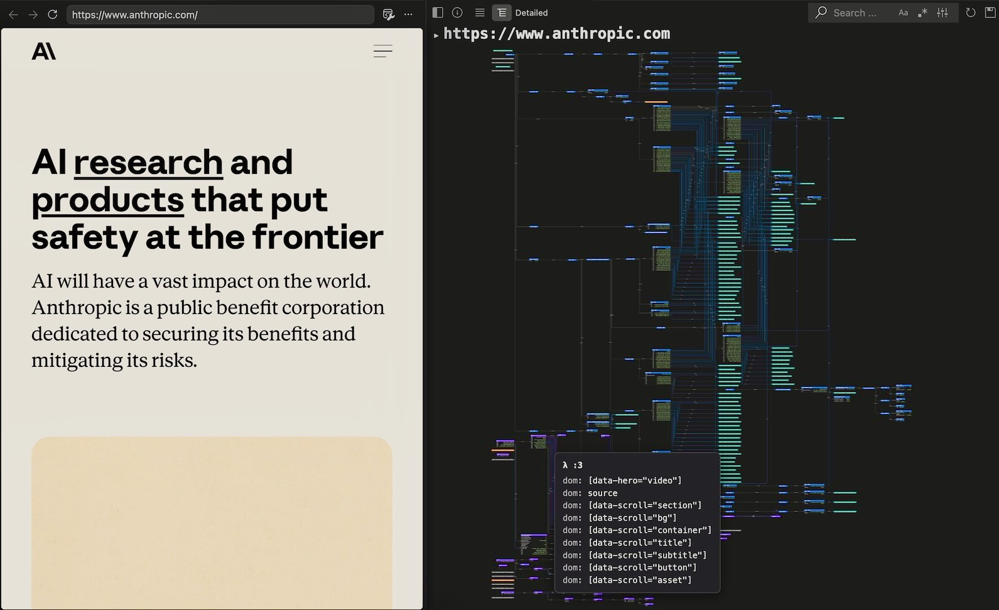
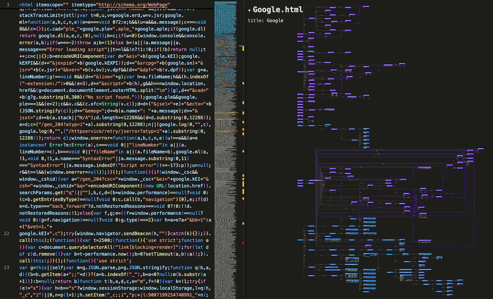
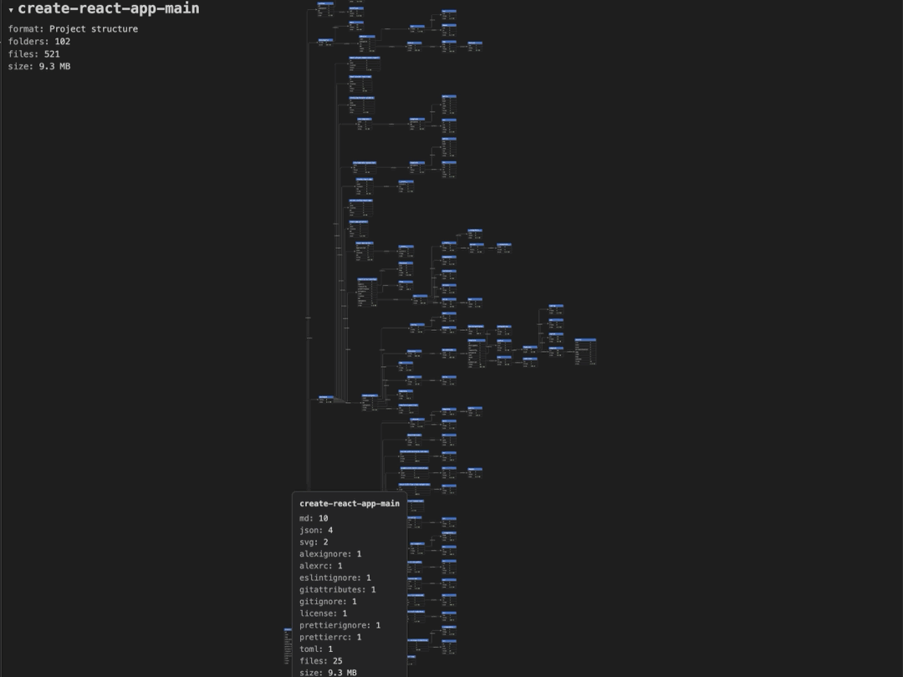
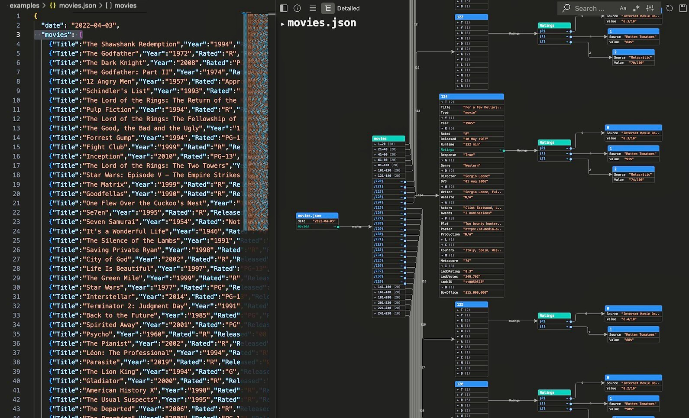
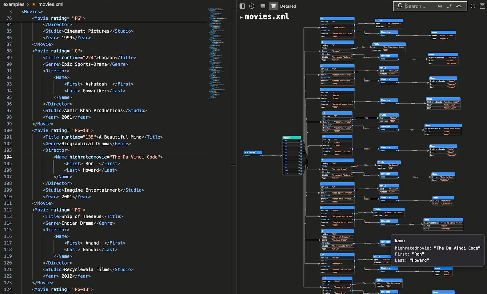
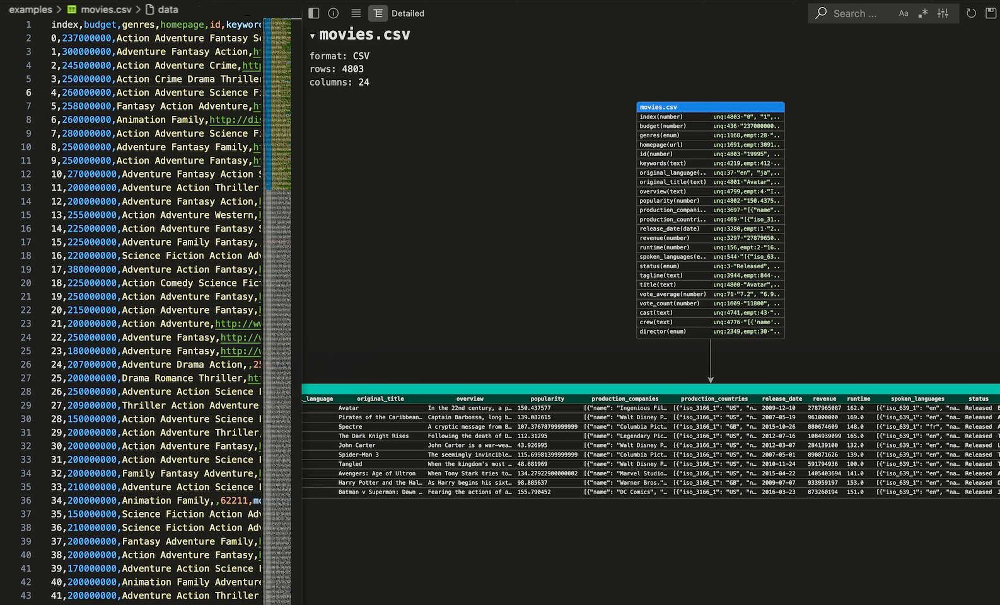

# Linear Code

**See any file as an interactive graph - 30+ formats, live, without leaving your editor.**

Open a file and Linear Code draws its *structure* beside the source: a JSON tree, a
CSV schema, a Parquet footer, a Python call graph, an OWL ontology, a PDF outline.
The graph is interactive - zoom, pan, search, and click a node to jump to the line
that produced it. It re-renders as you type, and one toggle switches between a
compact overview and a detailed view with every attribute, row, and column statistic.

Use it to:

* **Read a data file you can't read by eye.** CSV, Parquet, ORC, Avro, Pickle, RDS,
  and log files open as a schema with per-column types, unique/empty counts, and a
  top-rows preview - including the binary ones. No pandas, no notebook, no conversion step.
* **Understand code you didn't write.** Python, JavaScript/TypeScript, C/C++, Go, Rust, PHP, R, Ruby/Rails,
  Shell, and Jupyter notebooks become a call graph: functions and classes as nodes, calls as
  edges, plus the imports, database/URL/file resources, and CLI args each one touches. Rails
  apps also get their ActiveRecord models and associations, routes, and views.
* **Get your bearings in an unfamiliar repo.** Point **Visual Project** at a folder and
  it maps the structure: directories as nodes carrying per-file-type counts and total
  size, files color-coded by type - so you can see a codebase's shape before opening
  a single file.
* **Inspect a schema or spec at a glance.** OpenAPI/Swagger as an endpoint map, XSD as
  a class diagram, RDF/OWL/Turtle as an ontology, and DTD, GraphML, DOT/Graphviz, XML,
  YAML, Markdown, PDF, and HTML each rendered in the shape that suits them.
* **Browse a knowledge bundle, not just a file.** An **OKF** (Open Knowledge Format)
  document renders its frontmatter as a typed, color-coded concept node with its schema
  as a real table - and every concept it references becomes a node showing that
  document's own type, title and status. Click one to open its graph, and walk the
  bundle the way its authors linked it.
* **See an Obsidian vault as the graph it already is.** Open any note and the whole vault
  renders around it: every note a node colored by its frontmatter `type`, every
  `[[wikilink]]` an edge labeled with the field that states it (`employed_by:: [[Acme]]`).
  Detailed view adds each note's properties, tags and task counts, plus orphan notes and
  links to notes that don't exist yet. Click a note to re-center the graph on it.
* **Read a LinkML schema as the model it describes.** A **LinkML** YAML file renders as a
  conceptual model rather than a key tree: classes as nodes carrying their own slots,
  `is_a` edges for the taxonomy, labeled associations between classes, and enums with
  their coded values. The slots nothing references are collected into one node, so a
  generated schema shows you its own loose ends.
* **See what an MCP server actually exposes.** Point **Visual MCP** at an MCP URL and
  get its tools with their input schemas, prompts, and resources - plus, on request,
  the real result of calling a read-only tool.
* **Graph a live web page or REST API.** Point **Visual Web** or **Visual API** at a URL
  and read the served page, or the API's endpoints and live response data.
* **Find out which backends a web app talks to.** Point **Visual Web API** at a page and it
  reads the served HTML and its scripts, works out which API endpoints the code calls, and
  maps them grouped by host - with request and response structures where the host publishes
  an OpenAPI descriptor or a safe GET can be sampled.
* **See which files are churning.** Any file's preview carries a cold/warm/hot dot from its
  git history - how recently and how often it changed, and who has been changing it.
* **See what a package really pulls in - before you install it.** **Visual Package**
  takes a name from PyPI, npm, crates.io, or RubyGems and draws its dependency tree:
  versions and version requirements, the optional extras each one hides behind a
  feature flag, and - on request - the packages that depend on it.

Everything renders locally in a VS Code webview - no server, no export step, and your
files never leave the editor.

## Install

Search **Linear Code** in the Extensions view (<kbd>cmd/ctrl</kbd>+<kbd>shift</kbd>+<kbd>x</kbd>),
or run `ext install linearcode.linearcode` in the command palette. Then open any
supported file - see [Usage](#usage) below.

## Use Cases and Examples

Each example shows the source file (or live page) on the left and the interactive Linear Code graph on the right.

### MCP - an MCP server's tools, schemas, prompts and resources

The **Visual MCP** command opens a session against an MCP server and maps everything it exposes - here Hugging Face's `@huggingface/mcp-services` (7 tools, 4 prompts, 26 resources), in Detailed view. Each violet tool node lists its parameters and the behavior hints the server itself declares (`annotations: readOnly, openWorld`), and links to a green `input` schema node carrying every argument's full description - plus an `output` node for the tools that declare one. Orange nodes are prompts, teal nodes are resources with their `uri` and `mimeType`, and the header panel holds the server's version, capabilities and usage instructions. Hover any node for its untruncated text. Tools are never called unless you pick them and type their arguments; the result then renders as its own node.

### API - a live REST API straight from its URL

The **Visual API** command finds an API's OpenAPI/Swagger descriptor from just its base URL - here Context7's public API (OpenAPI 3.0.0, 16 endpoints across 6 tags), in Compact view. Blue tag nodes group the violet endpoint nodes, each badged with its HTTP method and carrying its summary, auth, request body and response codes; the green schema nodes show the request/response structures and link to each other by field, so `SearchResponse` points at `Library` along its `results` field. Detailed view adds the real JSON the API returned when scanned.

### PACKAGE - dependencies in Python PyPi, Javascript NPM, Ruby Gem or Rust Crates repositories

The **Visual Package** command takes a package name from PyPI, npm, crates.io, or RubyGems and maps its dependency tree straight from the registry - each node a package with its version, and edges labeled with the version requirement. A shared dependency is a single reused node, so you see what's actually pulled in. Compact shows the direct runtime dependencies; Detailed adds the optional/feature-gated ones and one tier deeper, and can pull in the packages that depend *on* yours (in green). Node color separates the primary dependencies from optional and not-yet-resolved ones at a glance.

### Web - graph a live page straight from its URL

The **Visual Web** command opens a URL in the built-in browser and graphs its *served* HTML the same way - here `anthropic.com`, with DOM-access rows resolved onto the page's script functions.

### HTML - page structure with embedded scripts

`Google.html` as a page-structure graph: the container hierarchy merged with the functions and call graph parsed out of the page's embedded `<script>` blocks.

### PROJECT - folder and file structure

The **Visual Project** command walks a folder and maps its structure: each directory is a node carrying its per-file-type counts and total size, linked to its children. Files are color-coded by type - program, data, doc, image, config, and so on - so a codebase's shape and where its weight sits are visible before you open anything. Compact shows the folder tree alone; Detailed adds the individual files.

### JSON - nested records as a navigable tree

`movies.json` walked into a graph: the large `movies` array is bucketed into ranged groups, each movie object expands into property rows, and nested `Ratings` arrays branch out to their own source/value objects - shown here in Detailed view beside the source.

### XML - the element tree with attributes and nested elements

`movies.xml` as an element tree: every `Movie` carries its attributes and text as rows and links to its nested `Title`, `Director`, and `Name` elements. Hovering a node pops up its full, untruncated content.

### CSV - table schema, per-column stats, and a data preview

`movies.csv` (4,803 rows × 24 columns): a schema node detects each column's type (number, enum, url, date, …) with unique/empty counts, sitting above a top-rows data-preview table.

## Supported file types

| Format | Extensions | What the graph shows |
|--------|-----------|----------------------|
| **DATA:** |||
| JSON | `.json` | A node/edge graph (auto-detected nodes and edges) or the JSON walked as a tree. |
| XML | `.xml` | The element tree visualization. |
| XSD | `.xsd` | XML schema visualization. |
| DTD | `.dtd` | Document Type Definition visualization. |
| GraphML | `.graphml` | A node/edge graph hierarchy visualization. |
| YAML | `.yaml`, `.yml` | The mapping/sequence tree. |
| OpenAPI / Swagger | `.yaml`, `.json` | An endpoint map: tags as roots, one node per operation (method, path, parameters, responses). |
| LinkML | `.yaml`, `.yml` (with `name:` + `classes`/`slots`/`enums`) | The conceptual model the schema describes: each class a node with its own slots as `slot: range` rows, `is_a` inheritance edges, labeled associations where a slot's range is another class, and enums as nodes of values with their codes. Detailed adds descriptions and slot facets, custom types, and a **Disconnected Slots** node holding the slots no class uses. |
| CSV / TSV | `.csv`, `.tsv` | Table schema plus a top-rows data preview. |
| Parquet | `.parquet` | Table schema and per-column statistic with a data preview. |
| Pickle | `.pkl` | Dict/array schema and a data preview. |
| ORC | `.orc` | Table schema and per-column statistics with a data preview. |
| Avro | `.avro` | Table schema and per-column statistics with a data preview. |
| R Data File | `.rds` | R data file - data.frame / matrix / vector table schema, per-column statistics, and a data preview. |
| LOG | `.log` | Log file structure and statistic with top-rows data preview. |
| **DOCUMENTS:** |||
| Markdown | `.md`, `.markdown` | Document structure: the heading outline as a section tree, with content rows and detected resources (images, links). |
| OKF | `.md` (with `type:` frontmatter) | Open Knowledge Format concept: the YAML frontmatter as a typed root node (colored by `type`, with a per-bundle legend), `# Schema` as a real column table, headings and sub-headings as nested section nodes, and references as attribute rows. Documents the concept links to — body links plus `sources`, `computation`, `executor` and `attester` paths — become their own nodes carrying *that* document's frontmatter; click one to open its graph. `index.md` renders as a bundle hub. |
| Obsidian | `.md` (with `[[wikilinks]]`, `key:: value` fields, or inside a `.obsidian/` vault) | Vault knowledge graph: every note in the vault is a node (colored by frontmatter `type`, with a per-vault legend) and every resolved `[[wikilink]]` or embed an edge, labeled with the frontmatter key or dataview field that states it. Links resolve the way Obsidian does — by name, alias, or path. Compact shows the linked notes; Detailed adds each note's properties, aliases, tags, headings, task and link counts, orphan notes, and gray nodes for links to notes not yet written. Click a note to open its graph; unsaved edits relink live. |
| PDF | `.pdf` | Document structure: metadata header, outline/bookmark + page hierarchy, and detected resources (images, internal/external links, embedded files). |
| Graphviz / DOT | `.dot`, `.gv` | The DOT source rendered via d3-graphviz (SVG). |
| RDF/XML | `.rdf` | An OWL/RDFS ontology class diagram (classes as nodes, properties as rows/edges). |
| OWL | `.owl` | The same ontology class diagram (RDF/XML or OWL/XML functional syntax). |
| Turtle | `.ttl` | An RDF resource (instance) graph: resources as nodes with their type and attributes, and labeled relations between them. |
| HTML | `.html`, `.htm` | Page structure (container hierarchy, elements as rows, embedded JS, images, external resources). |
| **PROGRAMS:** |||
| JavaScript / TypeScript | `.js` `.jsx` `.ts` `.tsx` `.mjs` `.cjs` | Program structure + scope-resolved call graph (functions, classes, imports, detected resources) visualization. |
| C / C++ | `.c` `.h` `.cpp` `.cc` `.cxx` `.hpp` `.hxx` `.hh` `.ino` | Program structure + call graph (functions, classes/structs/enums with members, inheritance, methods, `#include` modules, file/URL resources, `getenv`/`#define`) visualization. |
| Go | `.go` | Program structure + call graph (functions, methods, structs/interfaces with fields and embedding, `import` modules, `pkg.Func` external calls, file/HTTP resources, `os.Getenv`/`flag`) visualization. |
| Rust | `.rs` | Program structure + call graph (functions, structs/enums/traits with fields and variants, `impl` methods and trait implementations, `use`/`mod` modules, `Type::fn` and macro external calls, file/HTTP resources, `env::var`/args) visualization. |
| PHP | `.php` | Program structure + type-level relations and resources visualization. |
| Shell | `.sh`, `.bash`, `.zsh`, `.ksh` | Shell script structure, call graph and resources visualization. |
| Python | `.py`, `.pyw` | Program structure + call graph (functions, classes, imported modules, resources) visualization. |
| R | `.R`, `.r` | Program structure + call graph (functions, modules, library calls, data frames with columns, file/URL resources, args/env) visualization. |
| Ruby / Rails | `.rb`, `.rake`, `.gemspec` | Program structure + call graph (classes, modules, methods), ActiveRecord models with associations, named hash/array data objects with create/read/write relations, and HTTP/file/route/view resources. |
| Jupyter Notebook | `.ipynb` | Notebook and program structure with call graph and resources. |
| **OTHER:** |||
| WEB | `url` | Web page open and static structure (html, js) visualization like in HTML. |
| REST API | `url` | REST API endpoints and structure visualization. |
| WEB API | `url` | **Visual Web API** — open a page, then map the backend APIs its code calls: endpoints grouped by host, with request/response structures from each host's OpenAPI descriptor where it has one, or inferred from live responses where it doesn't. Static read of the served HTML and scripts only — the page's JavaScript is never executed, so requests a page assembles at runtime are not discovered. |
| MCP server | `url` | MCP server map: tools with their input schemas, plus prompts and resources. |
| NPM package | `name` | **Visual Package: NPM** — search a package on npmjs.com, resolve its latest manifest, and map the dependency tree: packages as nodes (version, engines, and `core packages`/`extra packages` lists with counts) linked by `depends` relations labeled with the semver range; shared dependencies are reused nodes. Compact shows the package and its `dependencies`; Detailed adds `peerDependencies`/`optionalDependencies` (edge-labeled `peer`/`optional`) and one deeper tier, fetched lazily only when you switch. `devDependencies` are excluded. Optionally adds **dependant counts** — npm publishes no list of dependent names, only totals. |
| Gem package | `name` | **Visual Package: Gem** — search a gem on rubygems.org, resolve its latest version, and map the dependency tree: gems as nodes (version, summary, license, and a `core packages` list with count) linked by `depends` relations labeled with the requirement; shared dependencies are reused nodes. RubyGems has no optional-dependency concept, so `development` dependencies are excluded and there is no extra tier — Detailed adds the deeper layer. Optionally adds one layer of green **dependant** gems; the API returns names only, so the first N are shown with the true total as a row. |
| Crates package | `name` | **Visual Package: Crates** — search a crate on crates.io, resolve its latest non-yanked version from Cargo's sparse index, and map the dependency tree: crates as nodes (version, rust-version, and `core packages`/`extra packages` lists with counts) linked by `depends` relations labeled with the version requirement; shared dependencies are reused nodes. Compact shows the crate and its normal dependencies; Detailed adds the **optional, feature-gated** ones — each edge labeled with the Cargo feature that enables it (`derive`) — plus one deeper tier, fetched lazily. `dev` and `build` dependencies are excluded. Optionally adds one layer of green **dependant** crates — the crates that depend on this one, most-depended-on first. |
| PyPI package | `name` | **Visual Package: PyPI** — search a package, resolve its latest-version dependency metadata from pypi.org, and map the dependency tree: packages as nodes (version, requires-python, summary, and `core packages`/`extra packages` lists with counts) linked by `depends` relations labeled with the version specifier; shared dependencies are reused nodes. Compact shows the package and its direct runtime dependencies; Detailed adds the optional (extra-gated) dependencies and one deeper tier — fetched lazily only when you switch to Detailed. Optionally adds **dependant counts** — PyPI publishes no list of dependent names, only totals. |

## Linear Code features

* Live preview that updates as you type.
* Zoom, pan, and search for nodes in the graph.
* Graph information with compact and detailed view toggle.
* Node hierarchy view and search with interactive navigation in code and visual.
* **Document Files** visualization with interactive tracing and highlight.
* **Graph Files** visualization with interactive tracing and highlight.
* **Data Files** structure and top rows visualization.
* **Program Files** code and structure interactive visualization with call graph, internal and external resources.
* **OKF knowledge bundles** — a `.md` file whose frontmatter declares a `type` renders
  as an OKF concept instead of a plain Markdown outline: frontmatter keys as attribute
  rows, `# Schema` as a column table, and nodes colored by concept type with a legend
  built from the types that bundle actually uses. Linked concepts resolve from disk and
  are **clickable** — opening a linked document's graph — and unresolved links stay
  visible rather than disappearing, since a link may point at knowledge not yet written.
* **Obsidian vaults** — a note that uses `[[wikilinks]]` or dataview `key:: value` fields,
  or that sits in a folder with `.obsidian/`, renders as the whole vault's link graph with
  the opened note leading. Wikilinks inside code blocks, inline code and HTML comments
  (template boilerplate, dataview queries) are ignored, so they don't create phantom links.
  Links to notes that don't exist yet stay visible in Detailed view. Plain Markdown files
  outside a vault still get the document outline.
* **Visual Web** command prompts for a URL, opens it in the built-in Simple
  Browser, fetches the *served* HTML, and graphs it through the HTML converter
  (served HTML only; client-rendered SPA content won't appear).
* **Visual API** command prompts for a URL, fetches the *served* API document, and
  graphs its endpoints through the OpenAPI converter.
* **Visual Web API** command prompts for a page URL (and an optional API key), opens it in
  the built-in Simple Browser, then reads the served HTML and up to `webapi.maxScripts`
  of its script files to find the backend endpoints the page's code calls. Endpoints are
  grouped by host; each host is checked for an OpenAPI descriptor first, and only where none
  exists are a bounded number of parameterless GETs called to infer structures. Scripts and
  probes are fetched one at a time, never in a burst. Because the page's JavaScript is not
  executed, endpoints a page builds at runtime are not discovered.
* **Git change hotspots** put a cold / warm / hot dot before the file name in the info panel,
  with the detail on hover: when the file last changed, how many times, the week/month/year
  split, and the top three authors with a total. Read through VS Code's built-in Git
  extension; a file with no history shows no dot rather than a guessed one. Turn off with
  `linear-code.history.enable`.
* **Visual MCP** command prompts for an MCP server URL (and an optional API key),
  opens an MCP session and graphs the server's tools with their input/output
  schemas, plus its prompts and resources. Detailed view expands each tool's input
  schema and can show a real tool result: you pick which read-only tools to run and
  type their arguments.
* **Visual Project** command prompts for a folder (default: the workspace root) and
  maps its folder/file structure — each folder is a node showing its per-file-type
  counts, file count and total size, and each file is a leaf node colored by its
  type group (program, data, doc, image, config, graph, web). File leaf nodes appear
  in Detailed view; Compact shows the folder tree alone. Noise dirs (`.git`,
  `node_modules`, build outputs) are skipped.
* **Visual Package: (PyPi | Crates | Npm | Gems):** command prompts for a package name, connects to package management repository and
  maps its dependent packages structure to graph nodes and relation.

## Notes

This extension uses Microsoft VSCode telemetry to collect standard anonymous non-identifying usage data when turned on (default).

## Release Notes

See the [CHANGELOG](./CHANGELOG.md).
